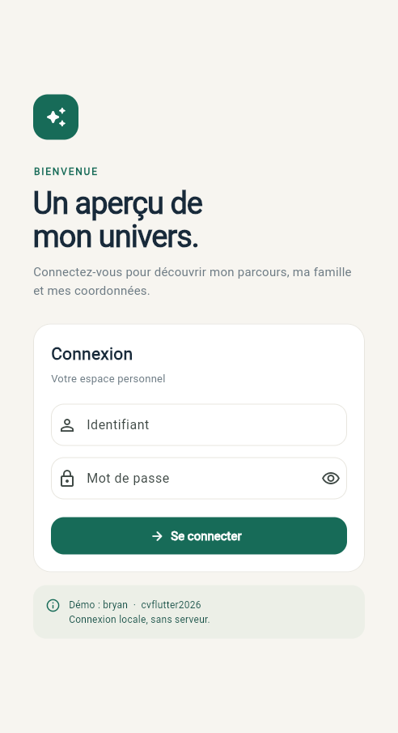
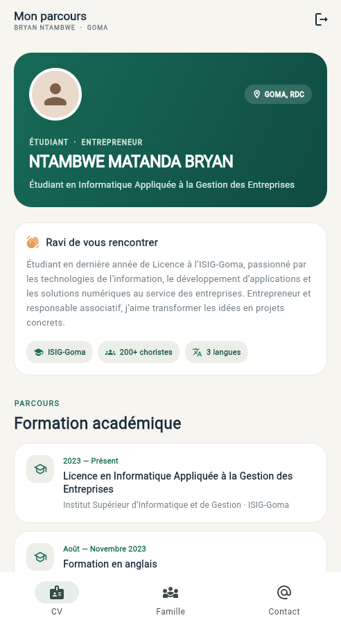
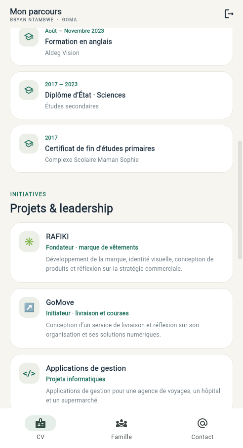
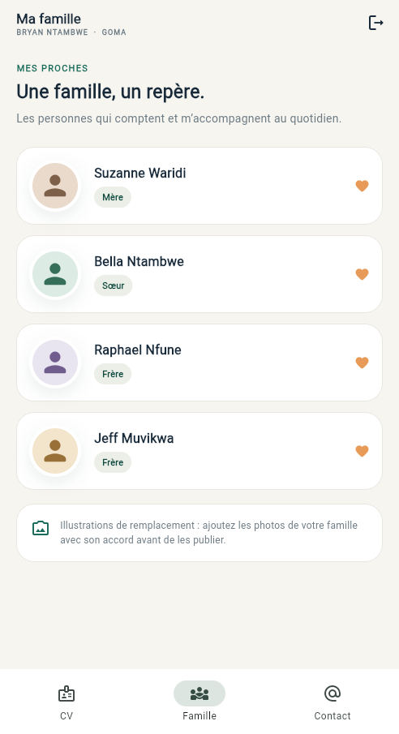
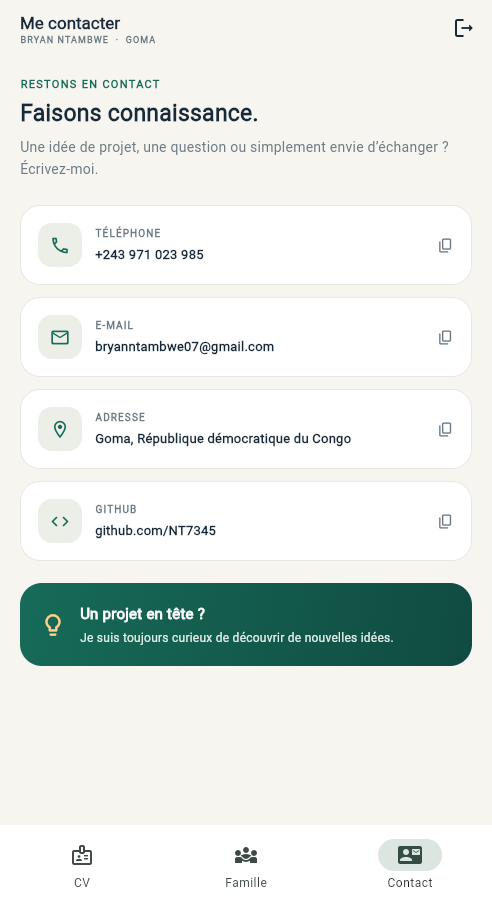

# CV Flutter · Bryan Ntambwe

Application Flutter multiplateforme qui présente mon parcours, ma famille et
mes coordonnées. L’interface est en français et s’adapte aux écrans mobiles.

## Captures d’écran

### Connexion



### CV et parcours






### Famille



### Contact



## Lancer l’application

```bash
flutter pub get
flutter run
```

Le projet inclut des cibles Android, iOS et Web. Pour vérifier le code :

```bash
flutter analyze
flutter test
```

## Démo de la connexion

- Identifiant : `bryan`
- Mot de passe : `cvflutter2026`

Cette connexion locale sert uniquement à la démonstration ; elle n’utilise ni
serveur ni système de comptes.

## Contenu

- **CV** : formation, projets, responsabilités, compétences, langues et
  centres d’intérêt.
- **Famille** : liste avec illustrations de remplacement. Aucune photo réelle
  n’a été fournie.
- **Contact** : téléphone, e-mail, adresse et GitHub ; un appui sur une
  coordonnée la copie dans le presse-papiers.

Le profil et les coordonnées sont ceux fournis pour ce projet. Le portrait et
les avatars de famille sont des illustrations génériques : aucune photo réelle
n’a été fournie.

## Dépendances

Flutter et Dart, avec `material_ui` et `cupertino_icons`.
