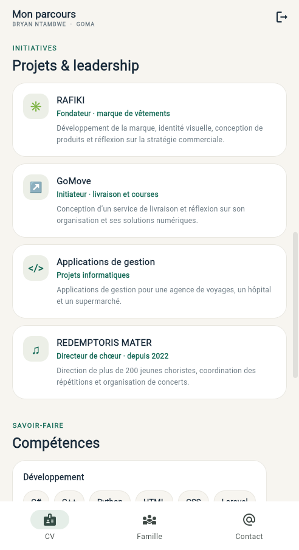
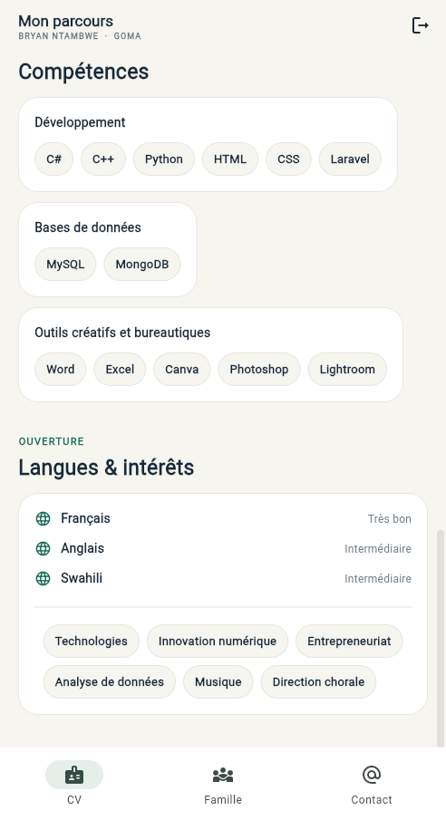

# CV Flutter · Bryan Ntambwe

Application Flutter multiplateforme qui présente mon parcours, ma famille et
mes coordonnées. La famille et les comptes sont gérés par l’API REST fournie
pour le TP2. Aucune vidéo de démonstration n’est incluse.

## Captures d’écran du TP1

### Connexion


### CV et parcours






### Famille (interface initiale du TP1)


### Contact


## API et base de données

L’application utilise l’API REST PHP décrite dans le dépôt
[espoirbaraka/api-test](https://github.com/espoirbaraka/api-test). Pour installer
le serveur local, suivez son README : placez l’API dans `C:\xampp\htdocs\api-test`,
démarrez Apache et MySQL, créez la base `api`, puis importez `api.sql`.

L’URL de base par défaut est `http://localhost/api-test/public`. Elle peut être
modifiée dans le champ **URL de base de l’API** de l’écran de connexion :

- Web ou Windows sur la même machine que XAMPP :
  `http://localhost/api-test/public`
- Émulateur Android :
  `http://10.0.2.2/api-test/public`
- Téléphone physique :
  `http://<adresse-IP-du-PC>/api-test/public` (même réseau local et accès
  Apache autorisé dans le pare-feu).

La connexion appelle `POST /accounts/login`. Le formulaire **Créer un compte**
appelle `POST /accounts/register`, puis vérifie la connexion. L’API stocke les
mots de passe sous forme de hash.

La page **Famille** charge les données avec `GET /famille-membres` et exécute
les ajouts (`POST`), modifications (`PUT`) et suppressions (`DELETE`) sur les
endpoints correspondants. Les champs obligatoires de l’API sont le nom, le
postnom, le prénom, le lieu et la date de naissance, ainsi que le lien de
parenté. Les données ne sont pas conservées comme source de vérité dans
l’application : l’API et sa base MySQL font foi.

> **Limite d’authentification de l’API fournie :** son README indique qu’aucun
> endpoint, y compris les routes de gestion familiale, ne requiert de session ou
> de jeton. L’application vérifie donc le compte auprès de l’API et garde son
> interface privée jusqu’à une connexion réussie, mais un client externe peut
> encore appeler directement les routes famille. Une protection serveur réelle
> nécessite de faire évoluer l’API pour émettre et vérifier une session ou un
> jeton sur ces routes.

Pour une connexion HTTP locale, les builds Android debug/profile autorisent le
trafic en clair. Les builds de production doivent utiliser une URL HTTPS.

## Lancer et vérifier l’application

```bash
flutter pub get
flutter run
```

Le projet inclut des cibles Android, iOS et Web. Pour vérifier le code :

```bash
flutter analyze
flutter test
```

Les tests utilisent un client HTTP simulé pour vérifier les requêtes et les
réponses attendues ; pour une démonstration en direct, le serveur XAMPP et la
base importée doivent être accessibles.

## Contenu

- **CV** : formation, projets, responsabilités, compétences, langues et
  centres d’intérêt.
- **Famille** : liste lue depuis l’API, formulaires d’ajout et de modification,
  suppression avec confirmation, et rechargement.
- **Contact** : téléphone, e-mail, adresse et GitHub ; un appui sur une
  coordonnée la copie dans le presse-papiers.
- Les photos sont facultatives dans l’API. Les illustrations génériques sont
  utilisées lorsqu’un membre ne possède pas de photo.

Le profil et les coordonnées sont ceux fournis pour ce projet. Aucun portrait
réel n’a été fourni.

## Dépendances

Flutter et Dart, avec `material_ui`, `cupertino_icons` et `http`.
